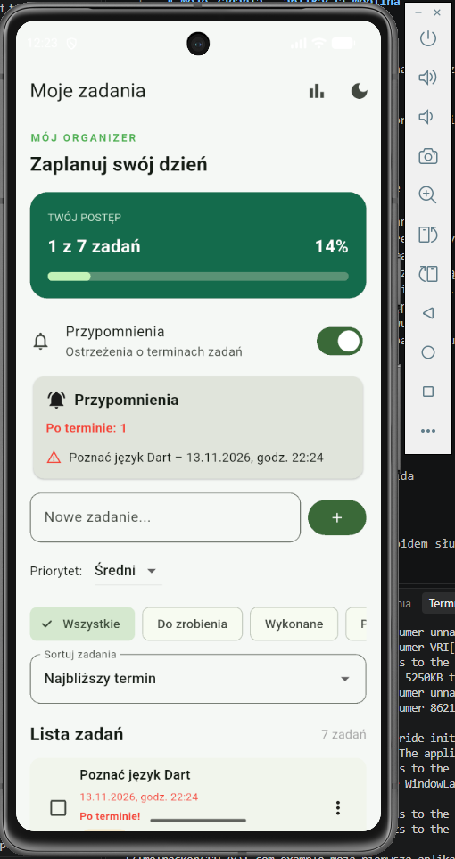
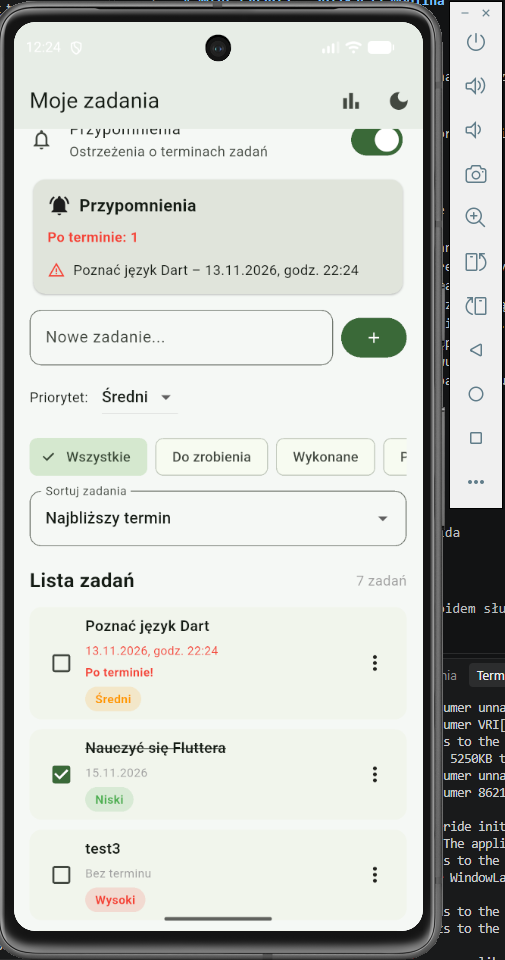
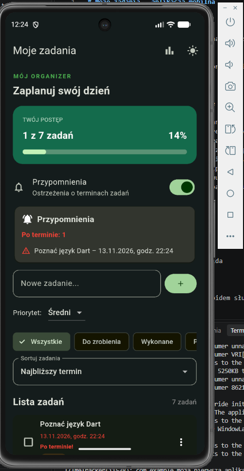
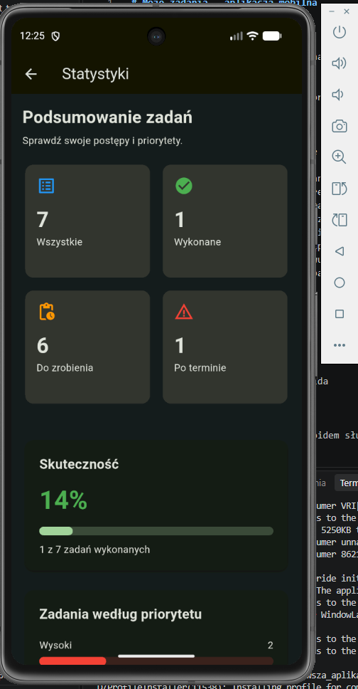
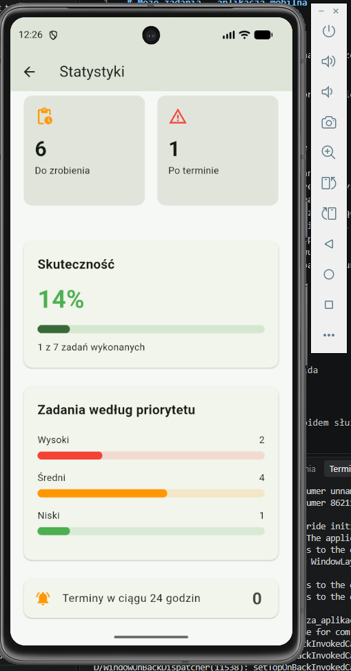

# Moje zadania – aplikacja mobilna

## Opis projektu

„Moje zadania” to aplikacja mobilna stworzona w technologii Flutter, umożliwiająca zarządzanie codziennymi obowiązkami, planowanie terminów i monitorowanie postępów.

Projekt został przygotowany z wykorzystaniem języka Dart.

## Funkcjonalności

- Dodawanie, edytowanie i usuwanie zadań.
- Oznaczanie zadań jako wykonane.
- Ustawianie daty i godziny wykonania.
- Nadawanie priorytetów: niski, średni, wysoki.
- Filtrowanie i sortowanie listy zadań.
- Informowanie o przekroczonych i zbliżających się terminach.
- Wyświetlanie statystyk realizacji zadań.
- Prezentowanie procentowego postępu.
- Obsługa jasnego i ciemnego motywu.
- Zapisywanie zadań i ustawień w pamięci urządzenia.

## Technologie

- Flutter
- Dart
- SharedPreferences
- Visual Studio Code
- Android Studio i emulator Androida

## Instalacja aplikacji

Do instalacji na telefonie z Androidem służy plik `Moje_zadania.apk`.

1. Przenieś plik APK na telefon.
2. Otwórz go na urządzeniu.
3. W razie potrzeby zezwól na instalację z danego źródła.
4. Zainstaluj i uruchom aplikację.

## Uruchomienie kodu źródłowego

Wymagane jest zainstalowane środowisko Flutter oraz skonfigurowane Android SDK.

Otwórz folder `kod_zrodlowy` w VS Code i wykonaj w terminalu:

```bash
flutter pub get
flutter run
```

## Przechowywanie danych

Aplikacja wykorzystuje SharedPreferences do lokalnego zapisywania zadań i ustawień.

Przypomnienia wyświetlane są wewnątrz aplikacji, a nie jako systemowe powiadomienia Androida.

## Cel projektu

Celem projektu jest praktyczne wykorzystanie technologii Flutter i języka Dart do stworzenia funkcjonalnej aplikacji mobilnej służącej do organizacji zadań.

## Zrzuty ekranu aplikacji

### Ekran główny


### Zadania i priorytety


### Ekran główny – tryb ciemny


### Statystyki – tryb ciemny


### Statystyki

